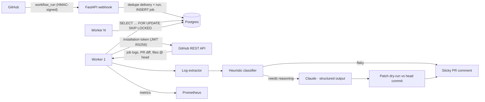

<h1 align="center">🩺 Mender</h1>

<p align="center">
  <b>Your failed CI, explained.</b><br>
  A GitHub App that diagnoses failed CI runs on pull requests and posts the root cause, plus a fix it has checked against your code.
</p>

<p align="center">
  <a href="https://github.com/Shibin506/mender/actions/workflows/ci.yml"></a>
  
  
  
  <a href="LICENSE"></a>
</p>

<p align="center"></p>
<p align="center"><sub>Real terminal output with Gemini 3.5 Flash, sped up (<a href="docs/demo.mp4">MP4</a>): a failing test, the diagnosis, a patch Mender verified by running the tests on a scratch copy, then <code>git apply</code> and green tests.</sub></p>

When a workflow fails on a PR, Mender reads the failed job logs, cuts them down to the few lines that matter, and works out the root cause with Claude, using the PR diff and the files the log points at. It posts one comment on the PR and keeps it updated. Any patch it suggests is first applied, in memory, to the PR's head commit. A patch that doesn't apply cleanly is never shown.

Flaky failures (network resets, registry rate limits, runner OOMs, timeouts) are recognised without a model call. Mender can also re-run those once automatically.

```
CI fails on PR ─► webhook ─► queue ─► worker: logs → extract → classify ─┬─► flaky?  → explain / re-run   (no model call)
                                                                         └─► Claude  → diagnosis + patch → dry-run apply → PR comment
```

## What a comment looks like

> ## 🩺 Mender CI diagnosis
>
> ### ❌ test (3.12) › `Run pytest`
> **Test failure** · high confidence
>
> **Coupon replaces the member discount instead of stacking with it.**
>
> `total` overwrites `discount` when a coupon is present.
>
> **Where:** `src/shop/pricing.py:7`
>
> **Fix:** Combine the discounts multiplicatively.
>
> <details><summary>Evidence from the log</summary>
>
> ```
> E       assert 90.0 == 81.0
> ```
> </details>
> <details open><summary>Suggested patch (applies cleanly to <code>3f2a9c1</code>)</summary>
>
> ```diff
> @@ -5,4 +5,4 @@
>          discount = 0.1
>      if cart.coupon:
> -        discount = cart.coupon
> +        discount = 1 - (1 - discount) * (1 - cart.coupon)
>      return round(subtotal * (1 - discount), 2)
> ```
> </details>
>
> <sub>Mender · workflow run · commit `3f2a9c1` · claude-opus-5-5 · $0.020 · react 👍 / 👎 to rate this diagnosis</sub>

*(Rendered from the test fixtures in `tests/conftest.py`.)*

## Architecture



| Stage | What it does | Where |
|---|---|---|
| Webhook | Checks `X-Hub-Signature-256` in constant time. Ignores runs that aren't failures. Deduplicates by delivery id and by `(repo, run, attempt)`. Enqueues and returns `202` well inside GitHub's 10 s limit. | `mender/app.py` |
| Queue | A Postgres table claimed with `FOR UPDATE SKIP LOCKED`, so any number of workers run without a broker or double-processing. Retries use full-jitter exponential backoff. Jobs whose worker died are reclaimed after a visibility timeout. Permanent errors such as an expired log (404) go straight to `dead`. | `mender/db.py` |
| GitHub client | Signs an RS256 app JWT, then mints and caches installation tokens until 5 min before they expire. Fetches the failed jobs and failing step, follows the log redirect, falls back to a commit→PR lookup for fork PRs, and edits its own comment instead of posting new ones. | `mender/github.py` |
| Log extraction | Strips timestamps, ANSI codes and runner noise, then scores each line against ~30 failure signatures (pytest, Jest, Vitest, tsc, ESLint, Go, Rust, Gradle, mypy, Ruff, npm, pip, plus OOM, timeout, network, secrets). It grows context windows around those lines, merges them, ranks them by score density and keeps what fits a character budget. It also pulls out repo-relative `file:line` references. | `mender/logparse.py` |
| Classification | Weighted signature groups decide the category. Transient infrastructure errors with no code-level evidence take the **no-model fast path**. | `mender/classify.py` |
| Diagnosis | The model (Claude, or Gemini via `MENDER_PROVIDER=gemini`) receives the excerpts, the PR diff (cut at file boundaries, and the model is told when it was cut) and the files the log names that the PR also changed. It returns a typed `Diagnosis` through structured outputs (a strict JSON schema on both backends). On Claude the server-side refusal fallback is enabled. Rate limits and overloads on either backend re-queue the job. | `mender/diagnose.py` |
| Patch check | A small unified-diff parser and applier that matches content exactly but tolerates line offsets, like `git apply` does. A patch that doesn't apply is dropped. | `mender/patch.py` |
| Comment | One sticky comment per PR. @-mentions in model or log text are neutralised, and code fences are lengthened so log content can't break out of them. | `mender/render.py` |

### Design decisions

- **Postgres as the queue.** A single dependency, transactional enqueue with dedup, and horizontal workers. `tests/test_queue_postgres.py` races 8 workers over 300 jobs and asserts each job is claimed exactly once. With `SKIP LOCKED` removed, the same test fails: one job is claimed 8 times.
- **Extraction before the model.** Typical failed-job logs here are ~3k lines. The extractor keeps about 0.3% of the characters (eval below), which keeps cost per diagnosis in cents and gives the model a sharper input.
- **Skip the model when it can't help.** A registry rate limit doesn't need a frontier model. The flaky fast path is tuned for precision: on both eval sets it never skipped the model for a real code failure.
- **Never post an unverified patch.** Models write diffs whose context lines don't quite match the file. Mender applies every patch to the head commit's files first, and only shows patches that apply. Applying isn't the same as being right, so `mender diagnose --verify-cmd "pytest -q"` also runs your tests on a patched scratch copy and hides the patch if they still fail. In testing, this caught a Gemini patch that applied cleanly but added the two discounts instead of compounding them.
- **Untrusted input.** Anyone who can open a PR controls the log, diff and file contents. They go in tagged blocks, and the system prompt tells the model to treat them as data. The output is plain text in a comment, never executed, and the bot only edits comments that a bot wrote, not ones where someone pasted its marker.
- **Prompt layout for caching.** Content that is stable per commit (diff, files) comes before content that changes per run (the log). Re-runs on the same head commit can then reuse the cached prefix.

## Evaluation

`eval/run_eval.py` builds a realistic CI log for each case: the real failure block buried in 1.5–4k lines of seeded runner noise, including deliberate distractors such as `test_error_message_is_readable PASSED` and `npm warn ERESOLVE`. It then scores the extraction and classification stages. No API key is needed, and it runs in CI.

| Metric | Tuning set (20 cases) | **Held-out set (10 cases)** |
|---|---|---|
| Must-see error line kept by the extractor | 100% | **100%** |
| Culprit file in top-3 extracted refs¹ | 100% | **50%** |
| Heuristic category accuracy | 100% | **50%** |
| Model calls skipped as flaky | 4 | 1 |
| …of which were wrong (real code failures skipped) | 0 | **0** |
| Share of log characters sent to the model (median) | 0.3% | 0.2% |

¹ Only over cases where the culprit file appears in the log at all.

The tuning set covers pytest, Jest, Go, Rust, tsc, ESLint, Ruff, mypy, npm, pip, Gradle, Docker, OOM, timeouts and missing secrets. I wrote the held-out set *after* tuning and scored it once. The numbers above are as measured. The held-out misses are formats the heuristics have never seen: Black, pnpm lockfiles, apt mirror 404s, `command not found` and Clippy. The important result is that extraction kept the evidence in every held-out case and the fast path never misfired, so those cases still reach the model with the right lines. The heuristic label is only a hint for the model.

### Model step

`python eval/run_eval.py --set all --llm` sends every case through the model as well. Results for **Gemini 3.5 Flash** on the free tier, run on 2026-11-15 (raw output in `eval/reports/`):

| Metric | Result |
|---|---|
| Cases answered | 26 of 30 (the other 4 hit the free tier's 20-requests-per-day limit and are not scored) |
| Failure type correct | **25 / 26** (the miss: it called a mypy error "lint", where the answer key says "build error") |
| File to fix named correctly | **17 / 19** (the misses: a Go test and a Jest snapshot, where the file to fix isn't shown anywhere in the case) |
| Patches drafted · applied cleanly | 2 · **2** |
| Median latency | 5.8 s |

The eval cases have no PR diff, and only 2 include the source files, so the patch numbers are thin. The live GitHub path also sends the diff and the files the log points at. Claude has not been run on this eval yet; the same command does it with `MENDER_PROVIDER=claude` and an Anthropic key.

## Running it

### 1. Create the GitHub App
Register an app from `app.yml`, or in **Settings → Developer settings → GitHub Apps**, with the permissions listed there. Subscribe it to **Workflow run** events and point the webhook at `https://<host>/webhooks/github`. Download the private key to `mender.private-key.pem`.

### 2. Configure and start
```bash
cp .env.example .env        # app id, webhook secret, and ANTHROPIC_API_KEY or MENDER_PROVIDER=gemini + MENDER_GEMINI_API_KEY
docker compose up --build   # Postgres + API on :8000 + 2 workers
```
For local development, expose port 8000 with a tunnel such as `cloudflared tunnel --url http://localhost:8000`. Set `MENDER_DRY_RUN=true` to log comments instead of posting them, and `MENDER_AUTO_RERUN_FLAKY=true` to re-run flaky jobs once.

### 3. Or try it without GitHub
```bash
pip install -e ".[dev]"
mender diagnose --log failed-job.log --repo-root ~/code/myrepo --base origin/main
mender diagnose --log failed-job.log --no-llm      # extraction + heuristics only, free
mender diagnose --log ci.log --base main --verify-cmd "pytest -q" --patch-out fix.patch
                                                   # write the fix only if your tests pass with it
```

### Endpoints
| | |
|---|---|
| `POST /webhooks/github` | GitHub webhook |
| `GET /` | dashboard of recent diagnoses |
| `GET /api/diagnoses`, `GET /api/stats` | JSON: categories, model-call share, patch apply rate, average cost and latency, queue depth |
| `GET /metrics` (API) · `:9100/metrics` (worker) | Prometheus: webhooks, jobs, tokens, USD spend, patch outcomes, log compression, end-to-end run time |

## Development
```bash
make install && make test                     # 70 tests on SQLite
MENDER_TEST_POSTGRES_URL=postgresql+psycopg://… pytest   # full suite + concurrency test on Postgres
make eval
```
The tests cover webhook signing and dedup, queue retry, dead-lettering and stale-job reclaim, the GitHub client (respx-mocked), pipeline paths (valid or invalid patch, flaky fast path, refusal fallback, rate-limit retry, stale head, fork PRs, dry run), comment sanitising, and the exact Messages API request, checked against a local fake server.

```
mender/
  app.py        webhook + JSON API + dashboard     db.py        models + SKIP LOCKED queue
  worker.py     job loop, retry policy, metrics     pipeline.py  one workflow run, end to end
  github.py     app auth, logs, PRs, comments       logparse.py  log → excerpts + file refs
  classify.py   heuristic categories, flaky path    diagnose.py  Claude structured diagnosis
  patch.py      unified-diff parse + dry-run        render.py    sanitised PR comment
eval/           tuning + held-out cases, runner
```

## Limitations and next steps
- Only the first 3 failed jobs in a run are analysed in depth, and the others are listed.
- On the GitHub App path, patches are checked for applying, not yet for passing the tests (`--verify-cmd` does that locally). Next step: push the patch to a scratch branch and let CI confirm it.
- Feedback reactions are requested but not yet collected back into the eval set.
- A per-repo config file for ignore lists and budgets.

MIT licensed.
